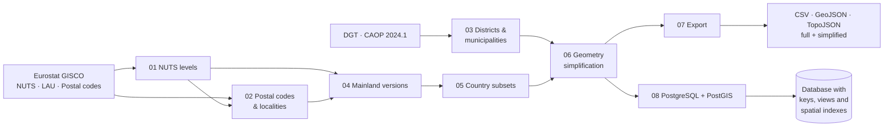
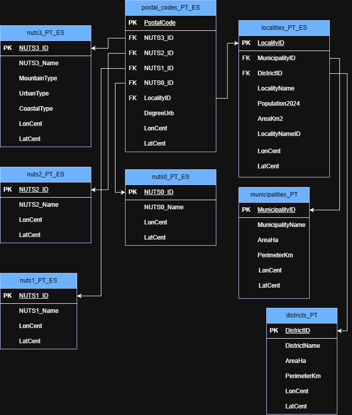

# Postal & Administrative Reference – Portugal and Spain

A geospatial pipeline in Python that builds a consistent geographic reference for **Portugal and Spain**: postal codes, localities, districts, municipalities and NUTS 0–3 regions, with and without the archipelagos.

The outputs are ready to use in **Power BI**: CSV tables for the data model (Power Query) and GeoJSON/TopoJSON files for the Shape Map and Deneb (Vega-Lite) visuals.

**Tools:** Python · GeoPandas · Shapely · pandas · NumPy · TopoJSON · PostgreSQL + PostGIS (SQL) · Power BI

---

## Pipeline



| Notebook | What it does |
|---|---|
| `01_nuts_levels` | Filters PT and ES from the NUTS 2024 file and builds the four NUTS levels |
| `02_postal_codes_and_localities` | Cleans the postal codes and LAU localities, derives the NUTS hierarchy and adds missing postal codes by spatial join |
| `03_districts_and_municipalities_caop` | Joins the four CAOP files (mainland, Azores ×2, Madeira), each with its own CRS, into one EPSG:4326 table |
| `04_mainland_versions` | Removes the archipelagos: filters the point and locality tables and subtracts the dissolved archipelago polygon from every NUTS geometry |
| `05_country_subsets_pt_es` | Splits the layers into Portugal and Spain, with and without archipelagos |
| `06_geometry_simplification` | **Analysis:** compares tolerances (vertices, file size, area change, gaps/overlaps). **Execution:** topology-preserving simplification of all polygon layers |
| `07_export_csv_geojson_topojson` | Exports 8 CSV tables and every layer to GeoJSON and TopoJSON, in full detail and simplified |
| `08_load_to_postgis` | Loads the 8 tables into PostgreSQL + PostGIS, runs data quality checks and fixes in SQL, adds primary/foreign keys, indexes and views, and runs example queries (optional step) |

Each notebook saves its results as layers of `data/processed/layers.gpkg`, and the next notebook reads them from there. This way, every notebook can be run on its own, in order.

## Data model

The CSV tables are related in Power BI as shown below. The same model is enforced in the PostgreSQL database (notebook 08) with primary and foreign keys, using `snake_case` column names (e.g. `MunicipalityID` → `municipality_id`).



All relationships are one-to-many: the arrow points from the foreign key (many) to the primary key (one).

*Note:* `MunicipalityID` and `DistrictID` only match Portuguese localities, because the CAOP tables cover Portugal only.

## Main techniques

* Filtering and cleaning attribute tables while keeping the geometry (GeoDataFrames)
* Deriving the NUTS hierarchy from code prefixes (e.g. `PT11A` → `PT11` → `PT1` → `PT`)
* Reprojecting between national CRS (EPSG:3763, 5014, 5015, 5016) and EPSG:4326
* Spatial joins (`within`) to assign administrative IDs to new points
* Dissolving polygons (`union_all`) and spatial difference to create mainland-only geometries
* Calculating centroids in a projected CRS (EPSG:3035) for correct results
* Topology-preserving simplification (Douglas-Peucker on shared arcs, tolerance in metres): smaller files without gaps or overlaps between neighbouring polygons
* Converting GeoJSON to TopoJSON (shared arcs, smaller files for Power BI)
* SQL with PostgreSQL + PostGIS: DDL, data quality checks (duplicates, orphan keys, invalid geometries), primary and foreign keys, GiST spatial indexes, views, CTEs, window functions and spatial queries (`ST_Area`, `ST_Intersects`, `ST_Touches`, `ST_Contains`)

## Repository structure

```
├── data/
│   ├── raw/          # official source files (not included – see data/raw/README.md)
│   ├── manual/       # postal codes missing from the GISCO file
│   └── processed/    # intermediate layers (layers.gpkg)
├── docs/             # data model diagram
├── notebooks/        # 01 to 08, run in order
├── sql/              # DDL, constraints and Power BI views (PostgreSQL + PostGIS)
├── src/utils.py      # shared functions (centroids, spatial join, simplification, export)
├── outputs/          # csv/ and simplified geojson/ and topojson/ files (included)
└── requirements.txt
```

## How to run

1. Download the source files listed in [`data/raw/README.md`](data/raw/README.md) and place them in `data/raw/`.
2. Create an environment and install the dependencies (with [Miniforge](https://github.com/conda-forge/miniforge)):
   ```bash
   conda create -n geo-pt-es python=3.12 geopandas matplotlib ipykernel topojson sqlalchemy psycopg2 geoalchemy2
   conda activate geo-pt-es
   ```
   Or with pip: `pip install -r requirements.txt`
3. Run the notebooks in `notebooks/` in order, from 01 to 07.
4. *(Optional)* To run notebook 08, install [PostgreSQL](https://www.postgresql.org/download/) with the PostGIS extension. The notebook asks for the password of the `postgres` user (or reads it from the `PGPASSWORD` environment variable) and creates the `geo_reference` database.

## Outputs

**CSV** (`outputs/csv/`): postal codes, localities, NUTS 0–3, districts and municipalities.

**GeoJSON / TopoJSON** (`outputs/geojson/`, `outputs/topojson/`), organised by territorial scope. Every polygon layer is available in two versions: full detail and simplified (suffix `_simplified`, recommended for Power BI).

**The CSV tables and the simplified GeoJSON and TopoJSON files are included in this repository**, ready to download or to read directly from GitHub (for example, in Power BI). The full-detail map files are not included because of their size: they are created by running the notebooks.

| Subfolder | Content |
|---|---|
| `PT_ES_WithArchipelagos` | Portugal + Spain, including archipelagos |
| `PT_ES_Mainland` | Portugal + Spain, mainland only |
| `PT_WithArchipelagos` | Portugal, including Azores and Madeira |
| `PT_Mainland` | Mainland Portugal |
| `ES_WithArchipelagos` | Spain, including the Balearic and Canary Islands, Ceuta and Melilla |
| `ES_Mainland` | Mainland Spain |
| `Archipelagos` | Postal codes of the archipelagos only (including Ceuta and Melilla) |

## Data sources

* **Eurostat GISCO** – NUTS 2024, Local Administrative Units 2024 and Postal Codes 2024. © EuroGeographics for the administrative boundaries.
* **Direção-Geral do Território (DGT)** – Carta Administrativa Oficial de Portugal (CAOP), version 2024.1.

Version 2024.1 of the CAOP was used to keep the same reference year as the Eurostat data.
